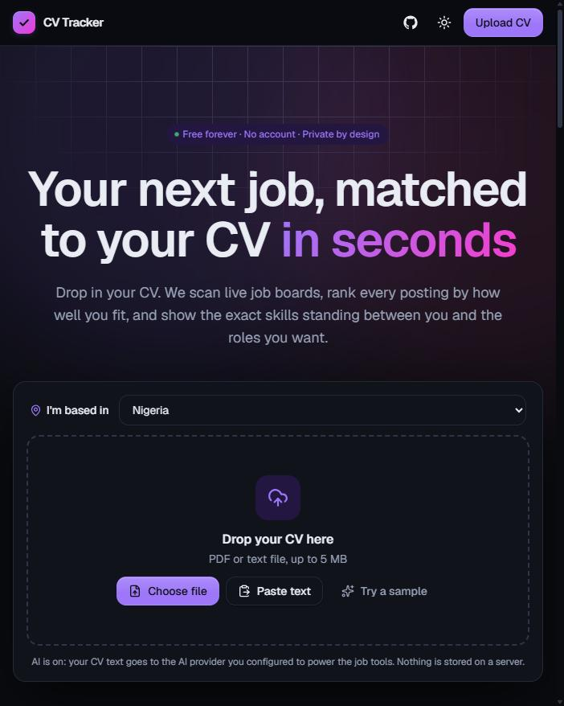
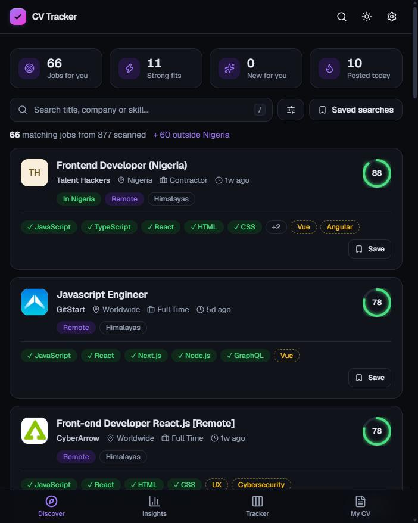
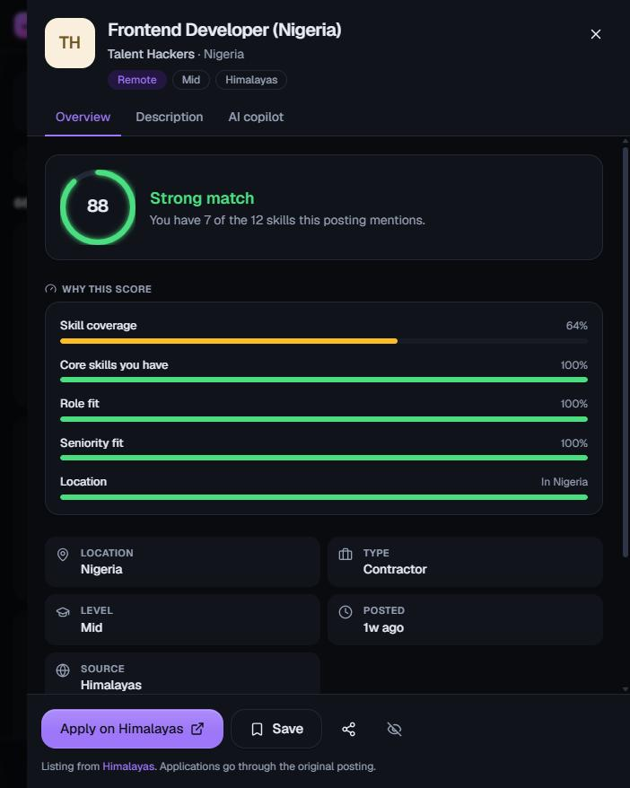
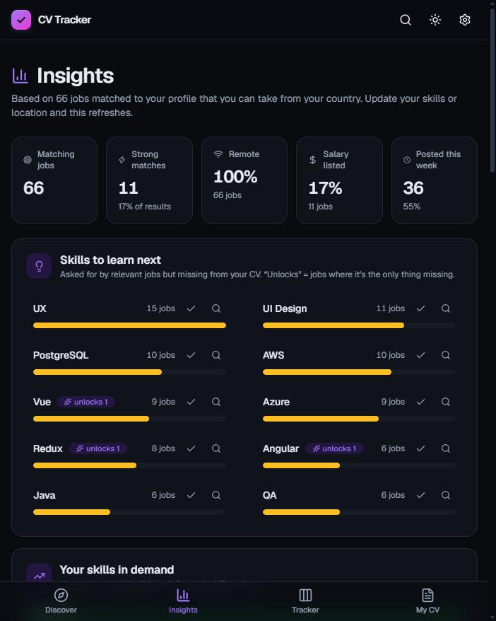
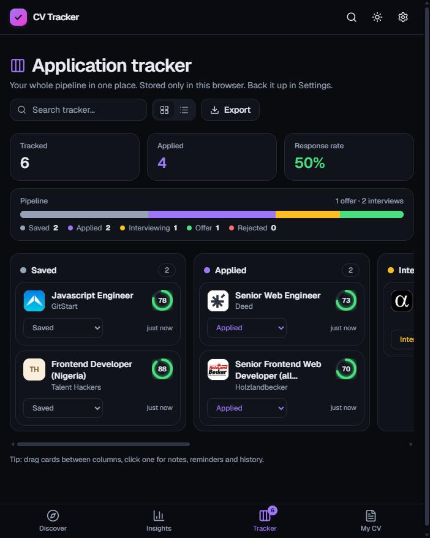
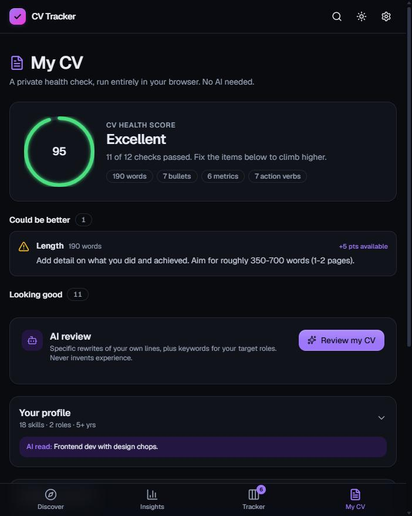
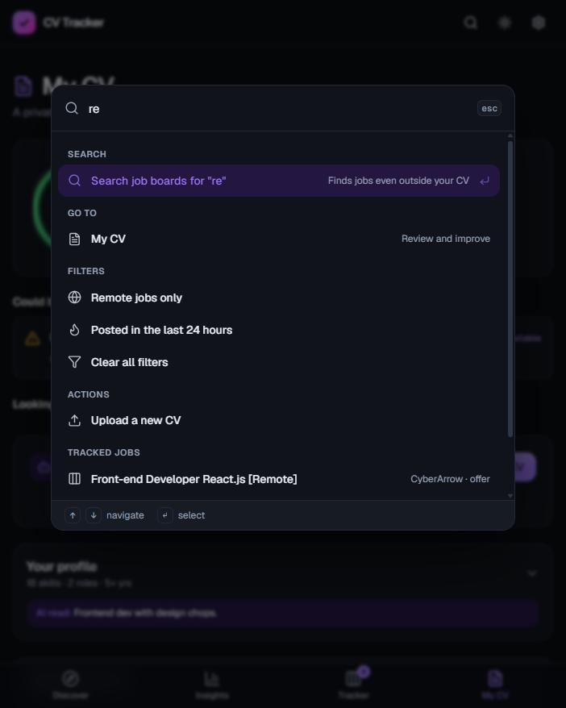
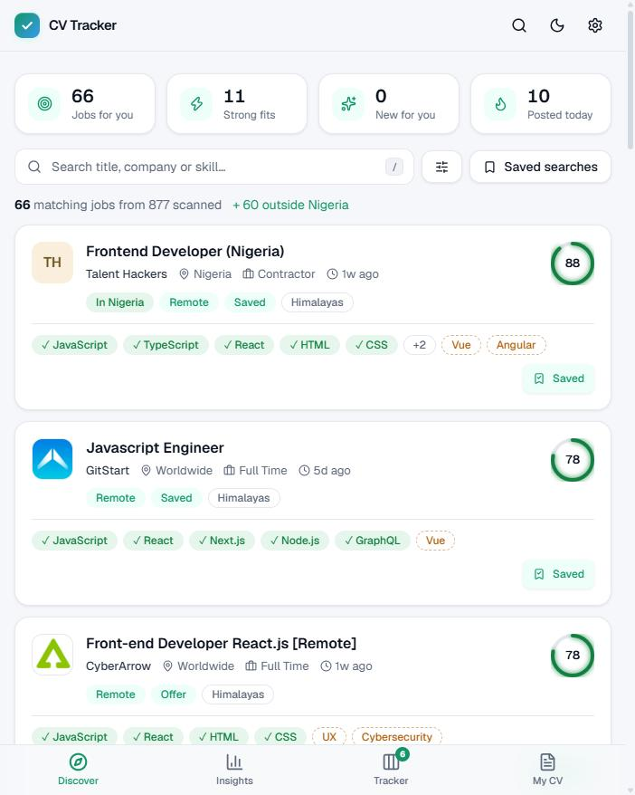

# CV Tracker

[](https://github.com/osoba-joshua/cv-tracker/actions/workflows/ci.yml)
[](LICENSE)

**Upload your CV. Get live jobs ranked by how well you fit, filtered to where you live. See exactly which skills to learn next. Track every application.**

Free forever, no account, no API keys required, and private by design: your CV and tracker never leave your browser.

| | | |
|:-:|:-:|:-:|
|  |  |  |
| **Landing** | **Discover** | **Why this score** |
|  |  |  |
| **Insights** | **Tracker** | **CV health check** |
|  |  | |
| **Command palette** | **Light theme, your accent** | |

## What it does

**Find**
- **Reads your CV** (PDF, text or pasted). Skills, roles and seniority are detected locally, and you can edit anything it got wrong. Results re-rank instantly.
- **Location aware.** Your country is detected from your browser. You see jobs in your country plus remote jobs that actually accept applicants from there. A switch adds jobs abroad.
- **Ranked matches.** Every job gets a 0-100 score. Open a job to see exactly why: skill coverage, core skills, role fit, seniority fit and location, plus the skills you have and the gaps to close.
- **Six live job boards** (Remote OK, Remotive, Himalayas, Jobicy, Working Nomads, Arbeitnow), merged and de-duplicated, refreshed hourly. Optional Jooble and Adzuna keys add local on-site jobs.
- **Smart search.** `react developer` (both words), `"product manager"` (exact phrase), `-senior` (exclude). Spelling variants match (`front-end` = `frontend`). Press Enter to search the boards for anything, even outside your CV.
- **Filters** for remote, minimum match, salary, posted date, location, level, source and "new since your last visit". Saved searches, removable filter chips and sorting.

**Understand**
- **Insights.** Skills to learn next (with how many jobs each would unlock), your skills' demand, salary range, who is hiring, where the jobs are, how fresh they are and which roles dominate.
- **CV health check.** A private, instant score with a prioritised checklist: length, contact details, impact numbers, action verbs, structure and more.

**Act**
- **Application tracker.** Board and list views, drag and drop, notes, follow-up reminders with overdue alerts, stage history, funnel stats and CSV export.
- **Free AI copilot** (optional): smarter CV reading, a fit check, tailored cover letters, interview prep, CV tailoring and an AI CV review. Works with free Gemini, Groq, OpenRouter or a local Ollama.

**Delightful**
- **Command palette** (`Ctrl/⌘ K`) to jump anywhere, apply filters or search.
- **Keyboard shortcuts** (`j`/`k`, `Enter`, `s`, `x`, `/`, `?`), toasts with undo, a native-style tab bar and bottom sheets on phones.
- **Make it yours**: light, dark or system theme, six accent colours, comfortable or compact density.
- **Installable** as an app on your phone or desktop. **Backup and restore** your data from Settings.
- **Accessible**: semantic markup, keyboard navigation, focus management, reduced-motion support.

## Quick start

You need [Node.js](https://nodejs.org) 20 or newer.

```bash
git clone https://github.com/osoba-joshua/cv-tracker.git
cd cv-tracker
npm install
npm run dev
```

Open http://localhost:3000 and upload your CV, or click **Try a sample**. No `.env` is needed.

## Free AI setup (2 minutes, optional)

1. Copy `.env.example` to `.env` (`cp .env.example .env`, or `Copy-Item .env.example .env` in PowerShell).
2. Get a free key from **one** of these and paste it into `.env`:
   - **Google Gemini**: https://aistudio.google.com/apikey -> `GEMINI_API_KEY`
   - **Groq**: https://console.groq.com/keys -> `GROQ_API_KEY`
   - **OpenRouter**: https://openrouter.ai/keys -> `OPENROUTER_API_KEY`
   - **Ollama** (runs on your computer, fully private): install from https://ollama.com, run `ollama pull llama3.2`, then set `OLLAMA_MODEL=llama3.2`
3. Restart `npm run dev`. AI buttons appear in each job and on the My CV screen.

You can set several. If one is rate limited or down, the next is tried automatically. Free tiers have daily limits, so results are remembered for the session and the AI only runs when you press a button. A per-visitor rate limit (`AI_RATE_LIMIT`, default 40 per hour) protects your quota if you deploy publicly.

**Privacy:** with AI on, your CV text and the job text are sent to the provider you chose when you press a button or upload a CV. Nothing is stored on this app's server. Without AI, nothing leaves the app except job searches. Model names and free limits change over time; override the model with `GEMINI_MODEL`, `GROQ_MODEL` or `OPENROUTER_MODEL` if a default stops working.

## Local jobs in your country

Most free job APIs only list remote work. For on-site jobs near you, add a free key:

- **Jooble** (covers Nigeria and 70+ countries): https://jooble.org/api/about -> `JOOBLE_KEY`
- **Adzuna** (UK, US, Canada, Australia, Germany, France, India, South Africa and more): https://developer.adzuna.com -> `ADZUNA_APP_ID` and `ADZUNA_APP_KEY`

Himalayas is queried with your country, so it already returns remote jobs that accept applicants from there.

## Scripts

| Command | What it does |
| --- | --- |
| `npm run dev` | Start the dev server |
| `npm run build` / `npm start` | Production build and server |
| `npm test` | Run the unit tests (Vitest) |
| `npm run lint` | Lint the code |
| `npm run typecheck` | Type-check with TypeScript |

CI (GitHub Actions) runs lint, type-check, tests and a production build on every push.

## How it works

```
app/                    Next.js App Router
  page.tsx, insights/, tracker/, cv/, settings/    the five screens
  api/parse, search, job, stats, ai/*              JSON API
  components/                                       UI (Landing, DiscoverView, JobDrawer, TrackerView, ...)
lib/
  store.tsx             one app store shared by every screen (profile, search, filters, tracker, toasts)
  skills.ts, profile.ts detect skills, roles, seniority (with strict matching for words like "Go" and "Excel")
  jobs.ts               fetch, normalise, de-duplicate and cache the job feeds
  geo.ts                countries, regions and "can I take this job from here?"
  match.ts              scoring: coverage, breadth, role fit, seniority, location
  search.ts, text.ts    search syntax and spelling normalisation
  insights.ts           skill gaps, salary, companies, freshness
  cvReview.ts           the CV health checklist
  ai.ts, prompts.ts     provider-agnostic AI client with fallback and rate limiting
tests/                  Vitest unit tests
```

**Scoring.** Skill coverage (weighted higher when a skill is in the job title) and breadth of core skills make up most of the score, then role fit against the title, a seniority check and a small bonus for jobs in your own country. Generic skills like Git count for less, and implied skills (React implies JavaScript) are never reported as gaps.

**Design system.** Colours, spacing and density are CSS variables. The accent is a single hue, tuned per colour for contrast in light and dark. Components follow one set of primitives (`card`, `btn`, `chip`, `input`) in `app/globals.css`.

### API

The UI uses these JSON endpoints, so other clients (for example a mobile app) can reuse them.

| Endpoint | Body | Returns |
| --- | --- | --- |
| `POST /api/parse` | multipart field `cv`, or JSON `{ "text": "..." }` | `{ profile, text }` |
| `POST /api/search` | JSON `{ skills, titles, years, level, location: { country, city }, query? }` | `{ total, sources, localSources, results }` |
| `GET /api/job?id=...` | | `{ description }` (full text of a cached job) |
| `GET /api/stats` | | `{ jobs, sources, countries }` |
| `GET /api/ai/status` | | `{ enabled, providers }` |
| `POST /api/ai/profile` | JSON `{ text }` | `{ profile, provider }` |
| `POST /api/ai/job` | JSON `{ task: "fit" \| "cover" \| "prep" \| "tweak", cv, job, tone? }` | `{ result, provider }` |
| `POST /api/ai/cv` | JSON `{ cv, roles? }` | `{ result, provider }` |

## Deploying

It is a standard Next.js app. Any Node host works (Vercel, Railway, Fly.io, a VPS). Set `NEXT_PUBLIC_SITE_URL` to your public URL so share images resolve, add any optional keys as environment variables, and keep `AI_RATE_LIMIT` low if AI is on. The in-memory job cache and rate limiter are per instance, which is fine for a single server.

## Job sources and attribution

Listings come from [Remote OK](https://remoteok.com), [Remotive](https://remotive.com), [Himalayas](https://himalayas.app), [Jobicy](https://jobicy.com), [Working Nomads](https://www.workingnomads.com) and [Arbeitnow](https://www.arbeitnow.com), plus [Jooble](https://jooble.org) and [Adzuna](https://www.adzuna.com) if you add keys. Their terms ask for credit and a link to the original posting, so every job links back to its source and the app names the sources. Feeds are cached for an hour to stay within rate limits. If you deploy this publicly, review each provider's current terms.

## Contributing

Issues and pull requests are welcome. Run `npm run lint && npm run typecheck && npm test` before opening one. Never commit real API keys.

## License

MIT, see [LICENSE](LICENSE).
